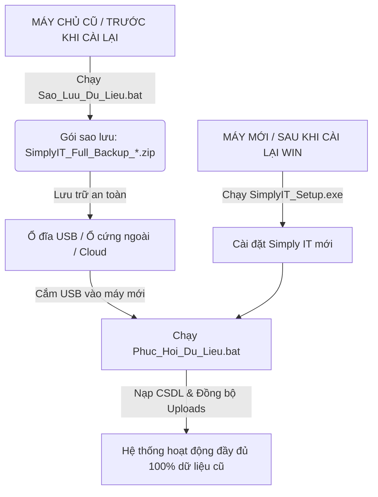

# HƯỚNG DẪN SAO LƯU & PHỤC HỒI TOÀN DIỆN DỮ LIỆU SIMPLY IT
## (Chuyển Đổi Máy Chủ Mới & Khôi Phục Thảm Họa Sau Khi Cài Lại Hệ Điều Hành)

---

## 📌 1. TỔNG QUAN KIẾN TRÚC DỮ LIỆU CẦN SAO LƯU

Hệ thống **Simply IT** lưu trữ toàn bộ dữ liệu nghiệp vụ của doanh nghiệp ở 3 thành phần chính:

```
📁 Thư mục dự án Simply IT (D:\QLTBIT hoặc D:\Antigravity\QLTBIT)
 ├── 🗄️ Cơ sở dữ liệu PostgreSQL (pgsql/data): Chứa 35+ bảng dữ liệu (Tài sản, Nhân sự, Bản quyền, Lịch sử bảo trì, Phiếu Ticket, Thiết lập hệ thống...)
 ├── 🖼️ Kho tài liệu & hình ảnh (public/uploads): Chứa ảnh chụp hiện trạng thiết bị, biên bản bàn giao, hóa đơn mua hàng, hợp đồng dịch vụ...
 └── ⚙️ Cấu hình hệ thống (.env): Thông tin tài khoản quản trị, thiết lập email SMTP, khóa bảo mật JWT...
```

> [!WARNING]
> **TẠI SAO KHÔNG NÊN DÙNG WINDOWS EXPLORER ĐỂ COPY TRỰC TIẾP CẢ THƯ MỤC SANG USB?**
> 1. **Lỗi khóa file `pg_internal.init`**: Khi PostgreSQL đang chạy, hệ thống liên tục ghi, khóa và giải phóng các file cache trong `pgsql\data`. Nếu copy bằng tay, Windows sẽ báo lỗi *"Item Not Found - Could not find this item: pg_internal.init"*.
> 2. **Nguy cơ hỏng CSDL (Corrupt Data)**: Copy thư mục database sống khi máy chủ đang hoạt động sẽ khiến file dữ liệu trên USB bị lỗi phân mảnh và không thể khởi động ở máy khác.
> 3. **Tắc nghẽn USB do `node_modules`**: Thư mục này chứa hàng chục nghìn file mã nguồn nhỏ, copy qua USB chuẩn FAT32/exFAT sẽ cực kỳ chậm (mất 30 - 60 phút) và rất dễ treo máy.
> 
> 👉 **Giải pháp chuẩn**: Sử dụng **Gói Sao Lưu Trọn Gói (.ZIP)** thông qua công cụ có sẵn của Simply IT (chỉ mất vài giây, bảo đảm an toàn dữ liệu 100%).

---

## 🚀 2. PHƯƠNG PHÁP 1: SAO LƯU & PHỤC HỒI BẰNG 1-CLICK (KHUYÊN DÙNG KHI CÀI LẠI WIN HOẶC CHUYỂN MÁY)

Simply IT đã tích hợp sẵn 2 công cụ tiện ích 1-Click độc lập ngay tại thư mục gốc:

### A. Sao lưu nhanh toàn bộ dữ liệu ra File ZIP hoặc USB:
1. Mở thư mục dự án Simply IT.
2. Nhấp đúp chuột vào file: **`Sao_Luu_Du_Lieu.bat`**.
3. Màn hình sẽ hiện menu lựa chọn:
   - **Phím [1]**: Sao lưu toàn bộ vào thư mục `backups/` trên máy tính.
   - **Phím [2]**: Tự động nhận diện ổ đĩa USB đang cắm và sao lưu thẳng vào USB (rất tiện để mang sang máy khác).
4. Hệ thống sẽ tự động xuất database chuẩn SQL (không bị khóa file) + gom toàn bộ file ảnh/chứng từ trong `public/uploads` + cấu hình vào 1 file ZIP duy nhất (ví dụ: `SimplyIT_Full_Backup_2026-10-03_11-43-49.zip`).

---

### B. Phục hồi dữ liệu sau khi cài lại máy hoặc chuyển sang máy chủ mới:
1. Cài đặt phần mềm Simply IT trên máy tính mới (bằng file `SimplyIT_Setup.exe` hoặc copy bộ cài).
2. Nhấp đúp chuột vào file: **`Phuc_Hoi_Du_Lieu.bat`**.
3. Hệ thống sẽ hiển thị danh sách các bản sao lưu đã có:
   - Nhập số thứ tự (ví dụ: `1`, `2`...) để chọn bản sao lưu muốn phục hồi.
   - **HOẶC** kéo thả trực tiếp file `.zip` từ USB vào cửa sổ dòng lệnh rồi nhấn **Enter**.
4. Quá trình nạp lại cơ sở dữ liệu và khôi phục toàn bộ kho ảnh/hóa đơn sẽ diễn ra tự động 100%. Khi hoàn tất, bạn chỉ cần mở Simply IT lên là toàn bộ dữ liệu xuất hiện đầy đủ!

---

## 🌐 3. PHƯƠNG PHÁP 2: SAO LƯU & PHỤC HỒI QUA GIAO DIỆN WEB (DÀNH CHO QUẢN TRỊ VIÊN)

Nếu máy chủ vẫn đang bật và bạn muốn sao lưu/phục hồi trực tiếp trên trình duyệt:

### A. Tải xuống bản sao lưu toàn bộ (.ZIP):
1. Đăng nhập vào trang quản trị với quyền **Admin**.
2. Truy cập: **Cài đặt hệ thống (Settings)** ➔ Chọn tab **Sao lưu & Phục hồi** (hoặc Cài đặt chung).
3. Tại mục **Sao lưu toàn bộ hệ thống**, nhấn nút:
   👉 **`[ 📦 Tải xuống bản sao lưu toàn bộ (.ZIP) ]`**
4. Trình duyệt sẽ tải về gói ZIP chứa:
   - File `database_backup.sql`: Bản sao lưu cấu trúc và dữ liệu PostgreSQL chuẩn.
   - File `database.json`: Bản sao lưu 35 bảng định dạng JSON tương thích mọi nền tảng.
   - Thư mục `uploads/`: Toàn bộ hình ảnh thiết bị, hóa đơn, tài liệu đính kèm.
   - File `manifest.json`: Thông tin chi tiết về gói sao lưu.
5. Lưu file ZIP này vào USB hoặc Google Drive / OneDrive của bạn.

---

### B. Phục hồi dữ liệu từ file ZIP trên giao diện Web:
1. Mở trang quản trị Simply IT trên máy mới hoặc sau khi cài lại.
2. Vào **Cài đặt hệ thống (Settings)** ➔ **Sao lưu & Phục hồi**.
3. Nhấn nút:
   👉 **`[ 📤 Phục hồi từ gói .ZIP ]`**
4. Chọn file sao lưu `.zip` từ máy tính hoặc USB của bạn.
5. Hệ thống sẽ tự động giải nén, nạp lại CSDL, khôi phục toàn bộ tệp đính kèm và tự động làm mới trang.

---

### C. Cấu hình tự động sao lưu định kỳ ra Ổ đĩa ngoài / USB / NAS:
1. Trong mục **Tự động sao lưu theo lịch**:
   - Bật công tắc: **Kích hoạt tự động sao lưu**.
   - Tần suất: **Hàng ngày (Daily)** hoặc **Hàng tuần (Weekly)**.
   - Giờ chạy: **02:00 sáng** (thời điểm ít người truy cập).
   - Đường dẫn thư mục: Chọn ổ đĩa khác (Ví dụ: `D:\IT_Backups` hoặc ổ đĩa USB `E:\SimplyIT_Backups`).
2. Nhấn nút **Lưu cấu hình tự động**. Hệ thống sẽ tự động sao lưu theo đúng lịch đã hẹn mà không cần can thiệp thủ công.

---

## 💻 4. PHƯƠNG PHÁP 3: QUA MENU TRUNG TÂM ĐIỀU HÀNH (`qltbit_manager.py`)

1. Chạy file **`start_qltbit.bat`** tại thư mục gốc.
2. Tại Menu chính, chọn:
   👉 **`[8] 💾 Sao Lưu & Phục Hồi Dữ Liệu (Backup/Restore chuyển máy, lỗi Win)`**
3. Menu chuyên biệt sẽ hiện ra với đầy đủ các tính năng:
   ```text
   ==============================================================================
         SIMPLY IT — TRUNG TÂM SAO LƯU & PHỤC HỒI DỮ LIỆU TOÀN DIỆN
   ==============================================================================
     [1] 💾 Tạo Bản Sao Lưu Toàn Bộ (Database + File Ảnh/Chứng từ -> File ZIP)
     [2] 🔌 Sao Lưu Nhanh Toàn Bộ Trực Tiếp Vào Ổ Đĩa USB
     [3] 🔄 Phục Hồi Toàn Bộ Dữ Liệu Từ Bản Sao Lưu (.ZIP / .SQL)
     [4] 📋 Xem Danh Sách Các Bản Sao Lưu Hiện Có (Trong thư mục backups)
     [5] 📂 Mở Thư Mục Chứa Bản Sao Lưu (backups) trong Windows Explorer
     [0] ❌ Quay lại
   ==============================================================================
   ```

---

## 📋 5. QUY TRÌNH CHUẨN KHI CHUYỂN MÁY CHỦ HOẶC CÀI LẠI WINDOWS (STEP-BY-STEP DISASTER RECOVERY)

Khi gặp tình huống máy chủ bị lỗi hệ điều hành phải cài lại Windows, hoặc khi công ty cấp máy chủ mới:



### Bước 1: Tại máy tính hiện tại (Trước khi cài lại máy)
- Cắm USB vào máy tính.
- Nhấp đúp file **`Sao_Luu_Du_Lieu.bat`** ➔ Chọn phím **`2`** (Sao lưu trực tiếp vào USB).
- Kiểm tra trong USB đã có file dạng: `SimplyIT_Full_Backup_YYYY-MM-DD_HH-mm-ss.zip`.
- Rút USB ra an toàn.

### Bước 2: Cài lại hệ điều hành Windows hoặc chuẩn bị máy chủ mới
- Cài đặt hệ điều hành Windows bình thường.
- Cài đặt các gói cơ bản (Node.js LTS và Python nếu muốn dùng đầy đủ công cụ quản trị).

### Bước 3: Cài đặt Simply IT trên máy mới
- Tải hoặc copy bộ cài Simply IT sang máy mới (ví dụ đặt tại `D:\QLTBIT`).
- Chạy file **`SimplyIT_Setup.exe`** (hoặc `Cai_Dat_SimplyIT.exe`) để thiết lập ban đầu.

### Bước 4: Khôi phục toàn bộ dữ liệu từ USB
- Cắm USB chứa file backup vào máy mới.
- Nhấp đúp file **`Phuc_Hoi_Du_Lieu.bat`** trên máy mới.
- Kéo thả file `.zip` từ USB vào cửa sổ console và nhấn **Enter**.
- Nhấn **`y`** để xác nhận nạp dữ liệu.
- Màn hình thông báo: `🎉 [HOÀN TẤT] PHỤC HỒI DỮ LIỆU THÀNH CÔNG RỰC RỠ!`

### Bước 5: Khởi động và kiểm tra
- Chạy **`start_qltbit.bat`** hoặc mở biểu tượng Simply IT.
- Đăng nhập vào web (mặc định: `http://localhost:3001` hoặc IP mạng LAN).
- Toàn bộ danh sách thiết bị máy tính, nhân sự phòng ban, lịch sử bảo trì, file hóa đơn và ảnh chụp hiện trạng đều đã sẵn sàng!

---

## 🛡️ 6. NGUYÊN TẮC VÀNG VỀ AN TOÀN DỮ LIỆU (IT BEST PRACTICES)

1. **Áp dụng nguyên tắc 3-2-1**:
   - Có ít nhất **3** bản sao dữ liệu.
   - Lưu trữ trên **2** loại phương tiện khác nhau (Ổ cứng máy chủ + Ổ USB cắm ngoài).
   - Có ít nhất **1** bản sao lưu nằm ngoài văn phòng (Google Drive, OneDrive hoặc máy tính quản trị viên).
2. **Kiểm tra định kỳ**: Mỗi tháng nên thử phục hồi dữ liệu 1 lần sang môi trường thử nghiệm để đảm bảo file sao lưu luôn hoạt động tốt.
3. **Trước khi cập nhật phần mềm**: Luôn chạy file `Sao_Luu_Du_Lieu.bat` trước khi tiến hành nâng cấp hoặc cập nhật phiên bản mới.
